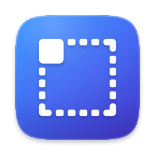

# Snaplite

[](https://github.com/Nekooo915/Snaplite/actions/workflows/build.yml)

轻量原生 macOS 截图工具。Swift 6 + 纯 AppKit 常驻层 + 按需加载 Liquid Glass 设置界面。

**~12.8 MB** 后台物理内存 · **0.0%** 静默 CPU · **~78 ms** 冷启动 · **455 KB**（arm64）/ **920 KB**（Universal）可执行文件 · 支持 **macOS 14+**（macOS 26+ 原生 Liquid Glass，macOS 14–25 自动 Material 降级）。

<p align="center">
  
</p>

## 功能

- **单一全局快捷键**：默认 `⌥A` 启动系统 `screencapture` 区域截图，按 **Space** 原生切换窗口截图；可在面板中直接录入新组合（自动校验冲突与系统保留快捷键，右键恢复默认）
- **截图后动作**：**复制 / 保存 / 复制并保存**三选一；纯复制模式零图像字节进入进程，复制并保存时使用内存映射 PNG 与按需懒加载 TIFF
- **保存目录**：默认 `~/Pictures/Snaplite/`（同秒自动递增 `(2)`、`(3)`，永不覆盖已有文件），支持一键更改、在 Finder 中打开，或直接将文件夹拖放到路径行
- **通用选项**：
  - **显示菜单栏图标**（隐藏后再次打开 `Snaplite.app` 即可唤出设置窗口）
  - **登录时启动**（原生 `SMAppService`）
  - **截图完成提示**（纯 AppKit Liquid Glass 轻提示，默认关闭）
- **权限引导**：实时显示「屏幕录制」授权状态，未授权时内联提供打开系统设置与一键重启入口
- **原生体验与极低常驻开销**：常驻进程 100% 纯 AppKit（`.accessory`，不显示 Dock 图标）；设置窗口按需创建，关闭即彻底释放视图树与窗口实例
- **系统级多语言**：支持简体中文（`zh-Hans`）与英文（`en`），遵循 macOS 系统及「系统设置 → 通用 → 语言与地区 → App」单应用语言偏好
- **平滑升级**：首次启动自动无损迁移 v0.1 `config.json` 配置至 `UserDefaults`
- **纯粹克制**：零网络、零遥测、零后台轮询

## 安装

到 [Releases](https://github.com/Nekooo915/snaplite/releases) 下载最新版本：

```bash
unzip Snaplite-v0.2.0-macos-universal.zip
mv Snaplite.app /Applications/
xattr -dr com.apple.quarantine /Applications/Snaplite.app
open /Applications/Snaplite.app
```

> 若从网络下载且未公证，使用 `xattr` 清除隔离属性以避免 Gatekeeper 拦截。

首次运行需在 **系统设置 → 隐私与安全性 → 屏幕录制** 中开启 Snaplite 权限，随后在面板中点击「重新启动」即可生效。

## 自行构建与签名

需要 **macOS 14+** 与 **Xcode Command Line Tools**（Swift 6）：

```bash
xcode-select --install          # 一次性安装 Swift / clang / iconutil
git clone https://github.com/Nekooo915/snaplite.git
cd snaplite

# 默认构建 Universal (arm64 + x86_64) .app (~920 KB)
bash scripts/bundle.sh

# 或仅构建 Apple Silicon (arm64) 快速本地开发 (~455 KB)
bash scripts/bundle.sh --arm64-only

open dist/Snaplite.app
```

### 持久签名（避免每次重新构建重置屏幕录制权限）

默认未设置 `SIGN_ID` 时，脚本使用 ad-hoc 签名（`--sign -`），每次重新编译后 macOS TCC 都会要求重新勾选屏幕录制权限。本地开发推荐在 **钥匙串访问 → 证书助理 → 创建证书** 中新建一张类型为「代码签名」的自签名证书（例如命名为 `Snaplite Local`），构建时传入 `SIGN_ID`：

```bash
SIGN_ID="Snaplite Local" bash scripts/bundle.sh --arm64-only
```

### 图标编译

- 安装了 **Xcode 26+**（含 `actool`）时，`scripts/bundle.sh` 自动将 Icon Composer 包 `assets/AppIcon.icon` 编译为 `Assets.car`（macOS 26+ 分层 Liquid Glass 图标）并写入 `CFBundleIconName`，同时保留 `AppIcon.icns` 供 macOS 14–25 回退。
- 仅安装 Command Line Tools 时，脚本自动回退为 `iconutil` 从 `assets/AppIcon.iconset` 生成 `AppIcon.icns`（静态浅色版：白底黑字）。
- 图标外观：**浅色模式白底 + 黑色图形**，**深色模式黑底 + 白色图形**（`assets/AppIcon.icon/icon.json` 按外观分别指定背景与图层填充）；`swift scripts/make-icon.swift` 可重新生成回退 PNG / icns 与图层 SVG。

### 持续集成（GitHub Actions）

[`.github/workflows/build.yml`](.github/workflows/build.yml) 在 `macos-26`（Apple Silicon）runner 上选用最新的 **Xcode 26.x**，依次执行 `swift test`、`scripts/bundle.sh`（Universal），并用 `actool` 将 Liquid Glass `.icon` 编译为 `Assets.car`（浅色：白底黑字，深色：黑底白字，`ACTOOL_STRICT=1` 下任何警告即失败）。产物 `Snaplite-v<版本>-macos-universal.zip` 与浅色 / 深色图标渲染图、`assetutil` 输出作为 workflow artifacts 上传；推送 `v*` 标签时自动附加到 GitHub Release。CI 仅做 ad-hoc 签名。本地仅装 Command Line Tools 的构建会回退为静态图标。

### 测试与性能测量

```bash
# 运行全部单元测试（20 tests / 5 suites）
swift test

# 测量二进制体积、冷启动耗时、物理内存 footprint、CPU、idle wakeups 与线程数
bash scripts/measure.sh dist/Snaplite.app
```

## 项目结构

```text
.
├── Package.swift                             -- Swift 6 包定义（macOS 14+）
├── Resources/Info.plist                      -- Bundle 元数据、LSUIElement、本地化声明
├── .github/workflows/build.yml               -- GitHub Actions：Xcode 26 测试、Universal 打包、.icon 编译与 artifacts
├── scripts/
│   ├── bundle.sh                             -- 构建（-Osize + WMO + dead_strip）、strip、vtool SDK 标记、图标与签名
│   ├── make-icon.swift                       -- 生成回退 iconset / icns 与 Icon Composer 图层 SVG（浅色 / 深色配色）
│   ├── render-icon.sh                        -- 渲染浅色 / 深色图标预览（ictool + NSWorkspace，CI 使用）
│   └── measure.sh                            -- 体积、冷启动、footprint 与 top 指标采集脚本
├── assets/
│   ├── AppIcon.icon/                         -- Xcode 26 Icon Composer 分层 Liquid Glass 图标包
│   ├── AppIcon.iconset/                      -- 多分辨率 macOS 26 网格对齐 PNG 回退集
│   └── AppIcon.icns                          -- 预生成回退 icns
├── Sources/
│   ├── SnapliteCore/                         -- 纯逻辑与系统能力层（零 SwiftUI 依赖）
│   │   ├── Capturer.swift                    -- /usr/sbin/screencapture 调度与防重入
│   │   ├── FileNamer.swift                   -- 唯一时间戳文件名生成与目录校验
│   │   ├── Hotkey.swift                      -- Carbon 全局快捷键、校验、ASCII 键位显示与 v0.1 迁移
│   │   ├── LoginItem.swift                   -- SMAppService.mainApp 封装
│   │   ├── Pasteboard.swift                  -- 内存映射 PNG + 懒加载 TIFF 剪贴板写入
│   │   ├── Permission.swift                  -- 屏幕录制权限检测、系统设置跳转与重启
│   │   ├── Preferences.swift                 -- @Observable 偏好设置与 v0.1 config.json 一次性迁移
│   │   ├── SingleInstance.swift              -- NSRunningApplication + DistributedNotification 单实例唤醒
│   │   └── Strings.swift                     -- en / zh-Hans 精简文案表
│   └── Snaplite/                             -- 应用入口与界面层
│       ├── main.swift                        -- .accessory 启动与单实例检查（纯 AppKit）
│       ├── AppDelegate.swift                 -- 生命周期、快捷键、截图与设置窗口编排（纯 AppKit）
│       └── UI/
│           ├── MenuBar.swift                 -- 懒更新 NSMenu 与矢量模板菜单栏图标（纯 AppKit）
│           ├── Toast.swift                   -- NSGlassEffectView / NSVisualEffectView 轻提示（纯 AppKit）
│           ├── Glass.swift                   -- Liquid Glass 与 macOS 14–25 Material 兼容修饰符
│           ├── SettingsWindow.swift          -- 按需创建、关闭即销毁的设置窗口控制器
│           ├── SettingsViewModel.swift       -- @Observable 设置状态与快捷键录入状态机
│           ├── SettingsView.swift            -- Liquid Glass 设置面板主体（含拖放目录支持）
│           ├── HotkeyRecorder.swift          -- Liquid Glass 键帽录入控件
│           └── PermissionCard.swift          -- 屏幕录制权限引导卡片
└── Tests/SnapliteTests/
    ├── FileNamerTests.swift
    ├── HotkeyTests.swift
    ├── PasteboardAndCapturerTests.swift
    ├── PreferencesTests.swift
    └── StringsTests.swift
```

## 许可

MIT
